# Blink Vault

Blink Vault is a Python application that backs up Blink security-camera clips
from Sync Module local storage to Google Drive. It maintains a **10 GB rolling
cloud backup**, with persistent transfer retries and a local buffer for clips
waiting to upload.

**Blink Vault never deletes recordings from Blink source storage.** Rolling
retention permanently deletes only app-tagged cloud backups in its designated
Google Drive folder.

The application is designed for an always-on Windows computer and includes a
local browser dashboard at [http://127.0.0.1:8765](http://127.0.0.1:8765).

## How it works

Blink Vault does **not** access the Sync Module XR+ microSD card directly over
the local network. BlinkPy uses Blink's internet API to request the local-storage
manifest, prepare individual clips, and download their video data. The Sync
Module must remain online.

```mermaid
flowchart LR
    XR[Sync Module local storage] --> API[Blink internet API]
    API --> Scan[Full manifest scan]
    Scan --> Queue[Persistent SQLite queue]
    Queue --> Download[Download and validate MP4]
    Download --> Staging[Local staging buffer]
    Staging --> Retention[Make room: expire oldest cloud copies]
    Drive --> Retention
    Retention --> Upload[Resumable Drive upload]
    Upload --> Verify[Verify size and MD5]
    Verify --> Drive[Rolling Google Drive backup]
```



Each cycle rescans the full available manifest and saves discovered clips to
SQLite before attempting transfers. It does not rely on a timestamp watermark,
so clips that appear late can still be discovered. Download and upload failures
have separate retry counters and deadlines that survive restarts.

## Requirements

- Windows 10 or a compatible Windows environment with **Python 3.11** and the
  Python launcher (`py`).
- An always-on, awake computer with internet access and space for staged clips.
- A Blink account whose Sync Module local-storage clips are accessible through
  BlinkPy, plus access to Blink's two-factor verification when required.
- An online Sync Module with healthy recording storage.
- A Google account with available Drive storage and a **Desktop app OAuth client**
  for the Google Drive API.

Dependencies are listed in
[requirements.txt](blink_drive_backup/requirements.txt). BlinkPy is pinned to
`0.26.0b0`; the application includes OAuth HTTP-202/2FA and runtime token-refresh
compatibility patches.

## Quick start

For an existing installation, follow [Upgrading](#upgrading) first to preserve
credentials, settings, and queued recordings.

1. Clone or download this repository, then open the `blink_drive_backup` folder.
2. In [Google Cloud Console](https://console.cloud.google.com/), create or select
   a project and enable the **Google Drive API**.
3. Configure Google Auth Platform, then create an OAuth client with application
   type **Desktop app**. Download its client JSON.
4. Double-click `START_DASHBOARD.bat`. The launcher creates `.venv` if needed,
   installs the required packages, and opens the local dashboard.
5. In **Connections**, select the Google client JSON and authorize Drive. Sign in
   to Blink, complete verification if requested, and select the Sync Module.
6. Click **Start backup**, then verify a real recording as described below.

The Google client JSON is saved as `client_secret.json` beside `backup.py`.
Account authorization and the transfer journal are stored in `state/`.
Normal restarts reuse saved authorization unless it expires or is revoked.

For manual startup, run these commands from the application folder:

```powershell
py -3.11 -m venv .venv
.\.venv\Scripts\python.exe -m pip install -r requirements.txt
.\.venv\Scripts\python.exe web_app.py --open --autostart
```

Keep the dashboard's Python process running. Closing the browser tab does not
stop backups. **Stop backup** requests a graceful worker shutdown; a current
transfer can finish before the process exits. The dashboard supervises its worker
and retries unexpected exits after roughly one minute.

### Google authorization

The application requests the limited
[`drive.file` scope](https://developers.google.com/workspace/drive/api/guides/api-specific-auth)
and creates its own backup folder. Preserve that folder's identity and ownership
tags; selecting an arbitrary existing folder can fail the app's safety checks.

For External OAuth projects left in **Testing**, Google issues seven-day refresh
tokens for these permissions. Check the project's publishing status in Google
Auth Platform. For unattended use, consider switching your personal project to
Production and obtaining fresh authorization if necessary. Production tokens
can still expire or be revoked.
[Google refresh-token documentation](https://developers.google.com/identity/protocols/oauth2#expiration)

## Verify your first backup

Successful authorization does not establish successful clip transfers.

1. Create a short, recognizable Blink recording and wait for it to appear in
   local storage.
2. Confirm a fresh successful manifest scan and find that clip in **Clip history**.
3. Look for `Downloaded:` followed by `uploaded:` in the activity log. An
   `aged_out` or `oversized` result is not a successful upload.
4. Open the exact MP4 in the designated Drive folder and confirm its content and
   duration by playing or downloading it.
5. Inspect pending jobs and errors, then restart the app and verify that another
   recording uploads without repeating authorization or duplicating the first.

The current code treats Blink's manifest size as **advisory**. It accepts a
structurally valid MP4 even when its downloaded byte count differs from that
metadata. It still checks MP4 box boundaries and required container elements,
then verifies the uploaded file's size and MD5. MP4 structural checks do not
fully decode the video or detect every kind of frame corruption.

On October 29, 2026, the user reported working transfers and provided a dashboard
showing 79 clips tracked as uploaded. This is useful operating evidence; playback
and checksums have not been independently inspected in the review environment.
The runtime token-refresh fix still needs confirmation after deployment and a
subsequent token expiry. See the [deployment fingerprints and live-transfer checklist](blink_drive_backup/PROJECT_REVIEW.md)
to identify the installed code and record transfer evidence.

## Configuration

Change settings through the dashboard while the worker is stopped, or edit
`blink_drive_backup/settings.json` while stopped.

| Setting | Default | Meaning |
| --- | ---: | --- |
| `max_bytes` | `10000000000` | Cloud clip budget: 10 decimal GB |
| `max_staging_bytes` | `10000000000` | Local retry-buffer budget: a separate 10 GB |
| `min_free_disk_bytes` | `1000000000` | Free-disk reserve checked before downloads |
| `poll_seconds` | `60` | Pause after a cycle finishes; minimum 60 seconds |
| `download_delay_seconds` | `2` | Delay between transfer attempts |
| `max_clips_per_cycle` | `50` | Maximum source-download attempts and upload selections per cycle |
| `folder_name` | `Blink Rolling Backup` | Name used when creating the Drive folder |
| `folder_id` | `null` | App-owned folder selected during setup |
| `module_id` | `null` | Sync Module selected during setup |

Polling is not an instant notification. Network calls, clip preparation,
downloads, and uploads add to the time between scans. Lowering `max_bytes` can
permanently expire excess cloud backups on the next real cycle.

## Retention and persistent retries

- Retention preserves the newest clips by **recording time**, across cameras on
  the selected module, and expires the oldest cloud copies first.
- Deletion rechecks the Drive parent folder, app ownership tag, clip key, and
  MP4 MIME type. Unexpected files or subfolders prevent Drive processing until
  the folder is corrected.
- To make room within the cloud budget, the app finishes a local download before
  deleting old cloud copies and uploading the new clip. If the upload fails,
  the staged clip remains for retry; expired cloud copies cannot be restored.
- Download and upload retries use persistent exponential backoff, approximately
  1, 2, 4, 8, 16, 32, then 60 minutes, with jitter and no retry-count cutoff.
- Missing source clips stay unresolved. They do not consume source-download
  attempt slots or block available clips solely by filling the batch.
- Once initialization succeeds, downloads can continue during Drive outages
  until the local buffer fills. **A Google failure during startup can still
  prevent Blink discovery**; this remains a documented limitation.
- A full buffer pauses downloads. Unknown-size clips use a reservation of up to
  100 MB; actual transfer size is checked afterward, so a download can transiently
  exceed the local budget.
- Resumable uploads, persisted Drive file IDs, reconciliation, and size/MD5
  checks help recover interrupted transfers without creating duplicate backups.

The cloud budget applies to this app's backed-up videos, not to unrelated Google
account files or existing Trash. The app never empties Drive Trash.
Keep separate copies of important footage that must outlive the rolling window.

Long outages, expired authorization, a sustained backlog, or exhausted local
storage can still cause missed clips. No application can recover footage that
Blink never exposes or removes before download.

## Commands and diagnostics

Run commands from `blink_drive_backup`. Stop the dashboard worker before starting
a separate setup or backup process.

| Command | Action |
| --- | --- |
| `START_DASHBOARD.bat` | Start the dashboard and automatically start a configured worker |
| `START_BACKUP.bat` / `SETUP.bat` | Open the same dashboard |
| `CHECK_STATUS.bat` | Show the last completed scan report |
| `.\.venv\Scripts\python.exe backup.py --status` | Read the saved report without signing in |
| `.\.venv\Scripts\python.exe backup.py --setup` | Perform interactive setup and manifest preflight |
| `.\.venv\Scripts\python.exe backup.py --once` | Run one real cycle, including uploads and retention |
| `.\.venv\Scripts\python.exe backup.py --run` | Run the standalone worker continuously |

`--once` is not a read-only diagnostic. A zero exit code alone does not prove all
transfers succeeded: individual failures are caught and queued for later retry.

| Path inside the application folder | Contents |
| --- | --- |
| `state/status.json` | Last cycle's scan status, counts, storage usage, and errors |
| `state/journal.sqlite3` | Persistent queue, retry deadlines, and completion history |
| `state/staging/` | Downloaded clips awaiting upload and transfer sidecars |
| `state/backup.log` | Rotated backup activity logs |
| `state/worker_console.log` | Worker startup and console output |

Check the freshness of `checked_at` in the saved report. A failed scan is not an
empty successful scan. Use the dashboard's individual or bulk retry control to
clear cooldowns when appropriate; do not delete the journal to reset retries.

### Blink manifest: TokenRefreshFailed

The pinned BlinkPy beta uses OAuth v2 for startup but its original runtime path
uses a legacy refresh flow when the access token expires. The application's
compatibility patch routes that runtime refresh through OAuth v2, serializes
concurrent refresh requests, and saves rotated tokens before the next request.
Failed refresh attempts retain the previous credentials and retry on later scans.
Short Windows file locks during atomic JSON replacement are retried with a
bounded delay; persistent save errors are still reported.

To apply this fix to an existing installation, stop the worker, close the
dashboard process, replace **both `backup.py` and `blink_compat.py`**, and restart
with `START_DASHBOARD.bat`. Preserve settings, credentials, and all of `state/`.
If refresh errors persist, stop the worker and reconnect **Blink** through
Connections, including 2FA if requested. Restarting the older version may restore
scans temporarily but does not correct its runtime refresh path.

A failed manifest scan can show zero pending clips even when new recordings
exist on Blink: clips not yet discovered cannot appear in the local queue.

For Windows Task Scheduler setup, see the
[detailed installation guide](blink_drive_backup/README.md#automatic-startup-on-windows).
Schedule one dashboard instance, keep the computer awake, and avoid running
multiple app installations against the same Drive folder. The process lock
protects a shared state directory, not separate installations on different hosts.

## Upgrading

1. Stop the worker, wait for it to exit, close the dashboard process, and disable
   any scheduled task that could restart it during the upgrade.
2. Copy updated application code, `requirements.txt`, `.bat` files, `web/`, and
   `tests/` from the new package into the existing app folder.
3. **Preserve your existing `settings.json`, `client_secret.json`, `.venv/`, and
   the entire `state/` directory.** Do not replace them with fresh defaults.
4. Start `START_DASHBOARD.bat`, inspect the queue and logs, and verify a real clip.

The [project review](blink_drive_backup/PROJECT_REVIEW.md) includes source
fingerprints for the advisory-size fix and the subsequent reliability update.

## Security and private files

The dashboard binds to **127.0.0.1** and uses CSRF tokens, Host/Origin checks, and
browser security headers. Access it on the server itself or through Remote
Desktop. Publishing the dashboard requires a separate authenticated deployment
design.

Keep `client_secret.json` and all of `state/` private. Blink's cache can contain
passwords and refresh tokens; Google's token grants account access. Logs and
recording filenames can also reveal camera names and recording times.

The repository's `.gitignore` excludes credentials, runtime state, recordings,
transfer sidecars, virtual environments, and ZIPs. **Ignore rules do not untrack
previously committed files.** The tracked settings file is a default template;
review changes before committing and keep deployment-specific configuration
out of GitHub. Never upload a live installation as a release ZIP.

## Tests and validation status

From the application folder:

```powershell
.\.venv\Scripts\python.exe -m unittest discover -s tests -v
```

The latest recorded validation on **October 29, 2026** passed **53 offline tests**
covering retention, deletion safeguards, queue persistence, independent retries,
Drive outages, late/missing clips, duplicate recovery, MP4 validation, dashboard
controls, and request protections. It also covered missing-source batch
starvation, Windows SQLite connection cleanup, OAuth v2 runtime refresh,
refresh-token rotation/persistence, concurrent refreshes, failed-refresh recovery,
and atomic credential saves under temporary Windows file locks.

That validation used existing dependencies rather than a clean package install.
An earlier generated real MP4 passed structural validation while a truncated copy
failed. These offline results do not independently establish live Blink
authentication/refresh, XR+ downloads, Drive uploads, or unattended Windows startup.
The runtime refresh patch requires a long-running deployed check. Details are recorded
in [PROJECT_REVIEW.md](blink_drive_backup/PROJECT_REVIEW.md).

## Cloud hosting considerations

The current implementation runs locally. A migration has not been selected.

**Apps Script** requires rewriting the Python/BlinkPy backend in JavaScript and
redesigning durable queue and staging storage. Before a full rewrite, prove Blink
login/2FA, token refresh, manifest retrieval, and one verified clip-to-Drive
transfer from Apps Script, then measure runtime and file sizes against its quotas.

**A scheduled Python Cloud Run job** can retain more backend code, but needs
durable queue/staging storage, protected credentials with persistent refresh
updates, cross-execution locking, and a billing assessment. Container-local files
are insufficient for reliable retries across job restarts.

See the [cloud feasibility comparison and cost assumptions](blink_drive_backup/PROJECT_REVIEW.md#hosting-comparison)
before replacing the Windows app.

## Project layout

```text
blink_drive_backup/
  backup.py          Worker, authentication, queue, transfers, reconciliation
  blink_compat.py    BlinkPy OAuth HTTP-202/2FA and token-refresh patches
  retention.py       Oldest-first cloud retention planning
  web_app.py         Dashboard server and worker supervision
  web/               Dashboard templates, JavaScript, and CSS
  tests/             Offline regression tests
  requirements.txt   Python dependencies
  settings.json      Default configuration; preserve installed settings
  README.md          Detailed installation and operating guide
  PROJECT_REVIEW.md  Deployment checks and cloud feasibility review
  *.bat              Windows launch and status scripts
```

## References

- [BlinkPy](https://github.com/fronzbot/blinkpy)
- [Google Drive Python quickstart](https://developers.google.com/workspace/drive/api/quickstart/python)
- [Google Drive OAuth scopes](https://developers.google.com/workspace/drive/api/guides/api-specific-auth)
- [Google Drive deletion behavior](https://developers.google.com/workspace/drive/api/guides/delete)
- [Google refresh-token expiration](https://developers.google.com/identity/protocols/oauth2#expiration)
